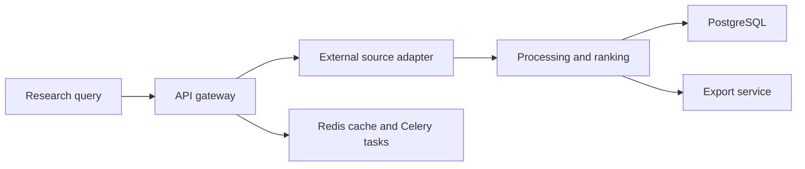

# Document Intelligence Services

**A document-processing service architecture with external-source adapters, asynchronous processing, caching, contextual analysis, persistence and file export.**

A document research workflow needs more than a generated answer: source retrieval, repeatable processing, storage, cached requests and export must retain a clear relationship to the originating material. The implementation divides these responsibilities between an API gateway and separate processing, source, cache and export services.

## Architecture and data flow



## Implementation decisions

1. The API gateway handles entry-point concerns while document-source access is isolated behind a dedicated service. This boundary allows a deterministic source contract to be tested without live source credentials.

2. Redis caching and Celery jobs separate repeated queries from heavier background processing. Service separation alone does not prove retry safety or idempotent processing.

3. Processing modules retain document context for classification and ranking. A ranking score is an implementation output; relevance and evidence correctness still need labeled evaluation.

4. PostgreSQL persistence and export are separate from generation. Exported results must be checked against the original document rather than assuming an LLM response is authoritative.

5. The mock generator accepts a seed and reference time so that date-dependent synthetic results can be reproduced. A mock result is explicitly different from a successful live integration.

6. The prepared copy uses neutral application identifiers. Original commercial titles, local customer configuration and private document sets are outside this candidate; the application is presented with neutral service identifiers and synthetic demonstrations.

## Source navigation

| Module | Responsibility |
| --- | --- |
| `backend/api_gateway` | Authentication and inbound APIs |
| `backend/pravo_tech_casebook_api_service` | External source contract and synthetic mock_data |
| `backend/data_processing_services` | Classification, contextual processing and ranking |
| `backend/cache_service` | Redis-backed cache boundary |
| `backend/file_export_service` | Spreadsheet/PDF export services |
| `frontend` | React/Vite application |

## Reproducible component checks

The minimal checks use Python 3.11/3.12 and `requirements-checks.txt`. They are independent of live accounts, paid APIs and GPU inference. They exercise the specific boundary described below; they are not a measurement of the complete application's model quality.

Linux/macOS, from the repository root:

```bash
python3.11 -m venv .venv
.venv/bin/python -m pip install -r requirements-checks.txt
.venv/bin/python offline_demo.py
.venv/bin/python -m unittest discover -s tests/offline -v
.venv/bin/python scripts/check_source.py
```

Windows PowerShell, from the repository root:

```powershell
py -3.11 -m venv .venv
& ./.venv/Scripts/python.exe -m pip install -r requirements-checks.txt
& ./.venv/Scripts/python.exe offline_demo.py
& ./.venv/Scripts/python.exe -m unittest discover -s tests/offline -v
& ./.venv/Scripts/python.exe scripts/check_source.py
```

### What the replay actually verifies

The existing source-response generator runs with a fixed seed and reference date on a fictional person/query. Tests cover response item structure, empty results and query variations. They do not call the real source, execute legal research, assess a model answer or verify the full asynchronous workflow.

The recorded example output is in [docs/offline-demo-output.json](docs/offline-demo-output.json). CI checks the minimal suite separately from a Gitleaks secret scan. Source compilation verifies syntax; it does not instantiate every runtime integration.

## Full runtime and configuration

Review `docker-compose.yml` and the service-specific requirements before starting the full system. `settings.json.example` describes local configuration structure; populated settings and credentials stay outside Git. Run `python scripts/prepare_config.py` to generate missing configuration copies. The synthetic source generator can be exercised without PostgreSQL, Redis, Celery or a live document source; the complete UI/API workflow requires those services.

Runtime dependencies and configuration notes are documented in [docs/runtime.md](docs/runtime.md). Minimal and full-runtime environments are intentionally separate. Filled local settings, credentials, production exports and original Git history are outside the source export. Configuration examples describe shape and environment references; they are not a working customer account.

## Evaluation protocol

Use a permitted document corpus with query relevance, extracted fields and source-span labels. Report retrieval recall, field-level extraction precision/recall, citation correctness, unsupported-answer rate, latency and processing cost. Integration tests should cover cache invalidation, duplicate jobs, export provenance and failures of the external source.

## Current boundaries

- No live-source availability or legal-answer accuracy is established by the mock contract.
- Multiple service configurations need a canonical, tested end-to-end deployment.
- Live credentials, customer document sets and deployment identities are excluded from this source release.

This repository presents the reviewed, anonymized source and the reproducible component checks described above. Private account configuration, customer identities, production documents, recordings and original deployment settings are excluded. Full application-level evaluation remains separate from the offline checks.

## Provenance and dependencies

The source export belongs to the author's local project family; technical component boundaries are recorded in [docs/source-provenance.json](docs/source-provenance.json). Third-party libraries, pretrained models and adapters retain their own licenses and attribution; see [THIRD_PARTY.md](THIRD_PARTY.md). No new permissive license is assigned by this documentation update.

Where present, [docs/original-guide.md](docs/original-guide.md) preserves the implementation guide with neutralized service names. It is reference material and must be read together with the current runtime and validation boundaries above. It is not a claim of production readiness.
